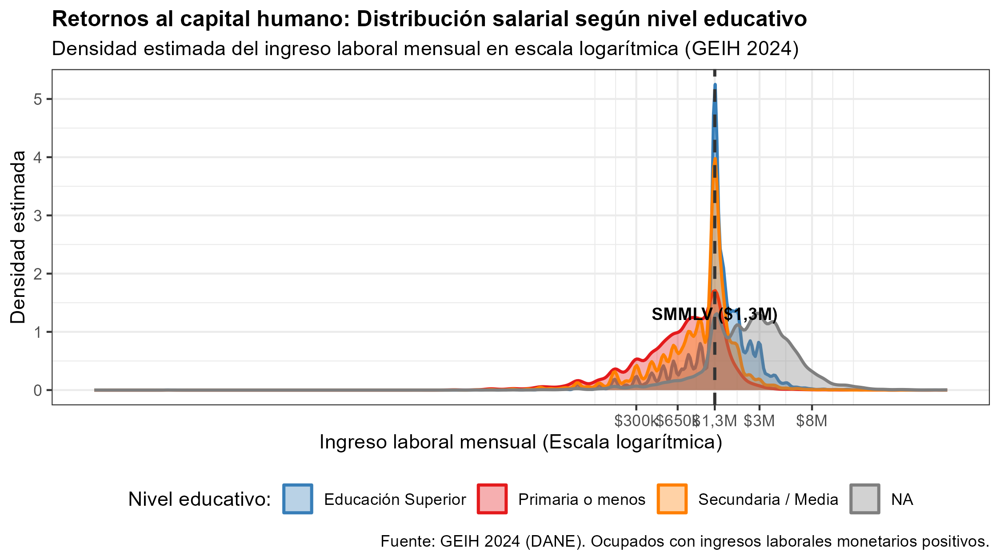
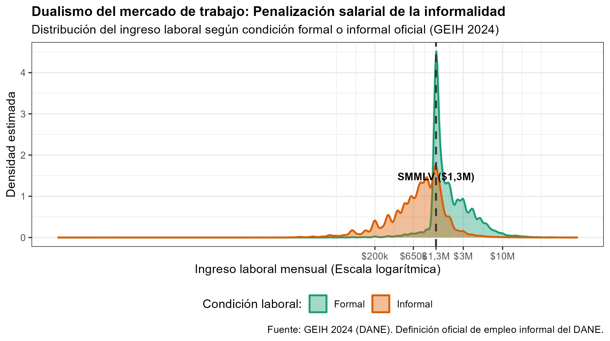
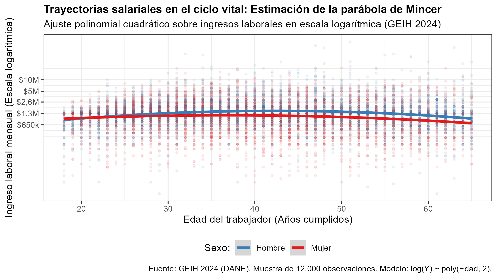
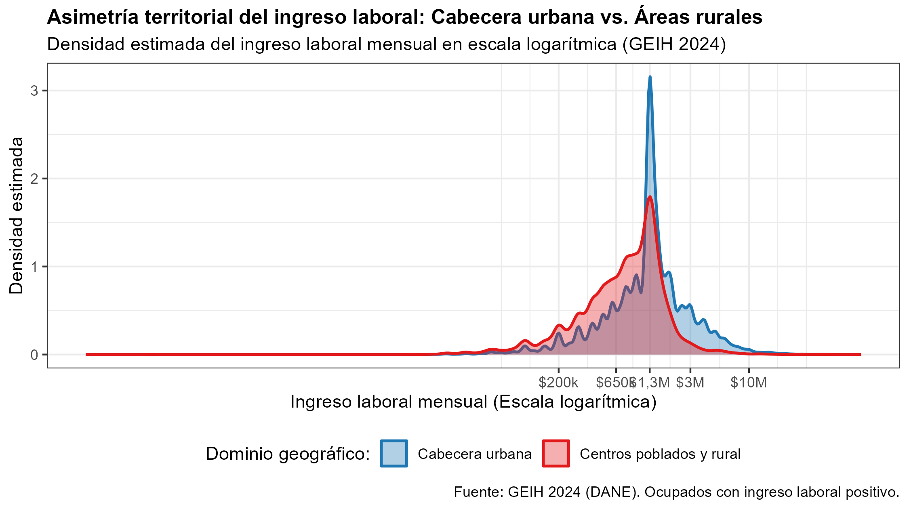
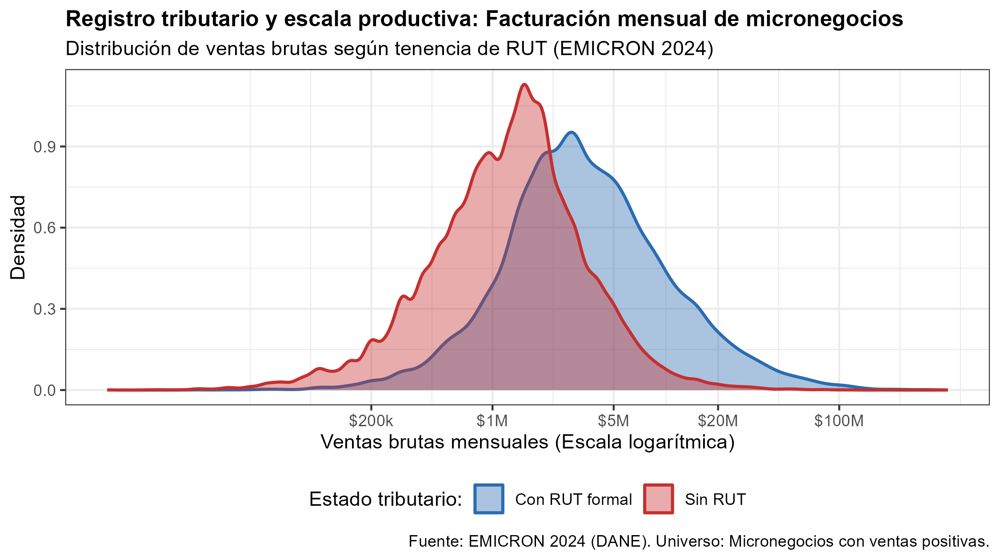
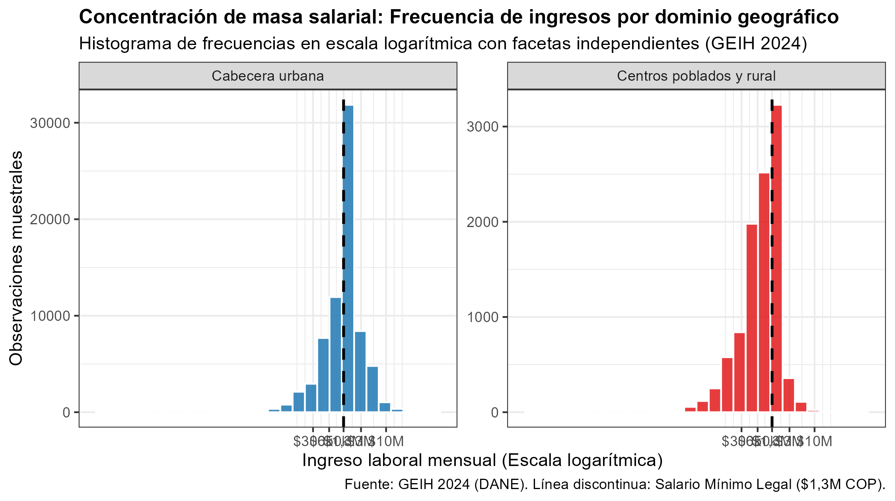
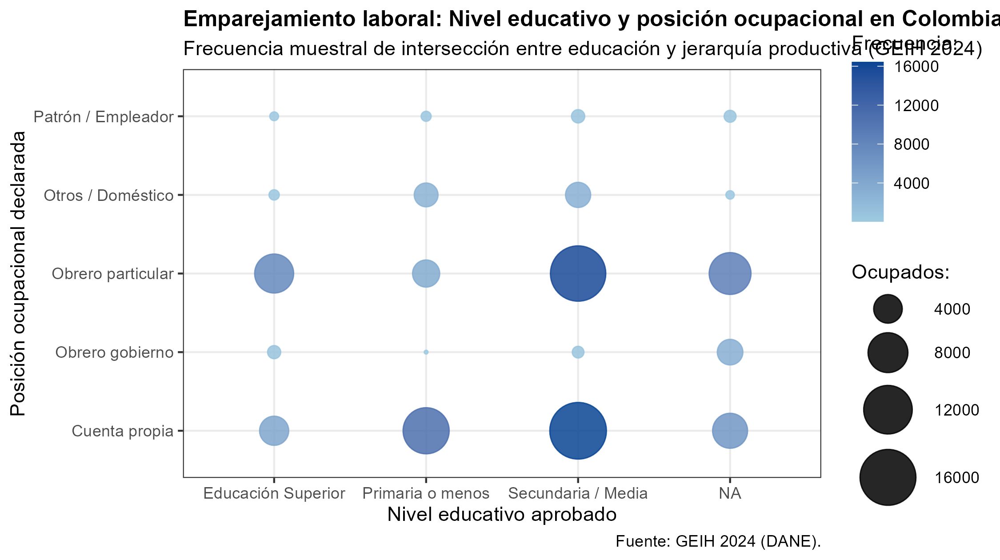
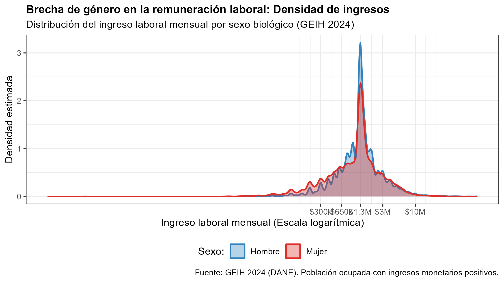
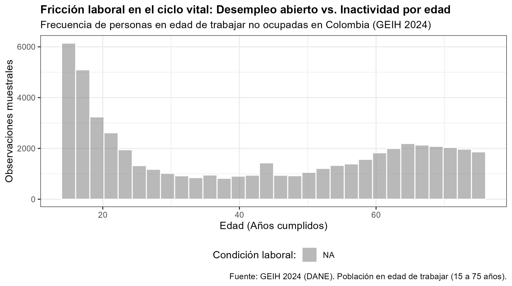
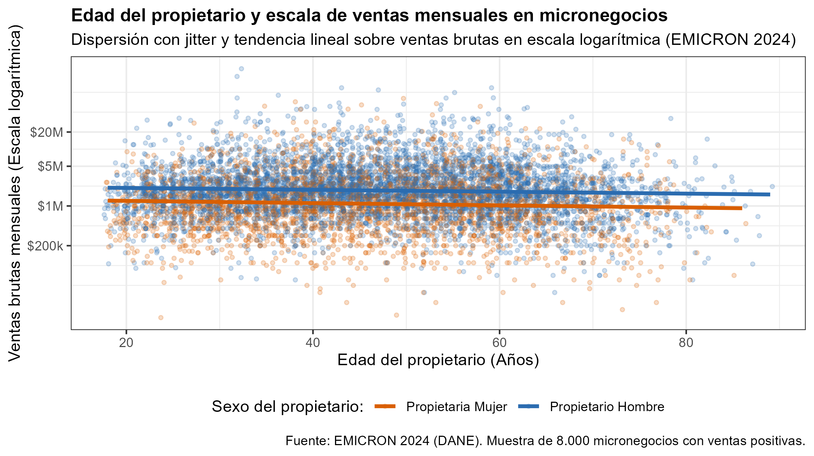

# Introducción y Criterios Metodológicos

El presente documento reúne diez (10) alternativas visuales para el **Punto 4 (Ejercicio Libre)** del Taller 2. Cada propuesta ha sido diseñada para cumplir estrictamente con los lineamientos del taller y optimizar el desempeño del grupo en la sesión de entrevista individual (50 % de la nota):

1. **Simplicidad y herramientas de clase:** Ninguna propuesta utiliza bucles `for`, funciones personalizadas (`function(...)`), acumuladores manuales ni paquetes externos no permitidos. Se emplean exclusivamente verbos básicos de manipulación (`filter`, `mutate`, `case_when`, `select`) y capas visuales de `ggplot2` estudiadas en las clases 6 y 7.
2. **Diferenciación gráfica (Literal a):** Son distintas de los formatos ya empleados en los puntos 2 y 3 (series de tiempo en paneles, torta, barras horizontales y barras agrupadas).
3. **Rigor teórico-económico:** Cada gráfica se fundamenta en modelos seminales de economía laboral, organización industrial o economía del desarrollo (Capital Humano, Dualismo Estructural, Ciclo de Vida de Mincer, Brechas de Género y Formalización Empresarial).
4. **Gráficas reales generadas:** Cada sección incluye la gráfica resultante renderizada a partir de los microdatos del DANE (GEIH y EMICRON 2024).

---

# 1. Distribución Salarial según Nivel Educativo

* **Tipo de gráfico:** Densidad continua multivariada (`geom_density`) con escala logarítmica y línea de umbral institucional.
* **Referencia en clase:** Clase 7 (líneas 157--160 del script de visualización).
* **Variables:** `INGLABO` (ingreso laboral monetario mensual) y `P3042` (nivel educativo más alto aprobado: Primaria, Secundaria/Media y Educación Superior).

### Sustentación Teórica
Se fundamenta en la **Teoría del Capital Humano** (*Becker, 1964; Mincer, 1974*). La adquisición de credenciales educativas superiores incrementa la productividad marginal del trabajo y la dotación de habilidades cognitivas complejas. En la distribución empírica, esto se traduce en dos efectos visibles: (i) un desplazamiento sustantivo de la masa salarial hacia la derecha, y (ii) una compresión casi total del riesgo de percibir ingresos inferiores al Salario Mínimo Mensual Legal Vigente (SMMLV de \$1,3M COP), el cual opera como una frontera inferior efectiva para la mano de obra calificada.

### Visualización Resultante


### Código en R
```r
datos_educ <- ocupados_2024_analisis %>%
  filter(!is.na(INGLABO), INGLABO > 0, !is.na(P3042)) %>%
  mutate(
    NIVEL = case_when(
      P3042 %in% c(1, 2, 3)    ~ "Primaria o menos",
      P3042 %in% c(4, 5)       ~ "Secundaria / Media",
      P3042 %in% c(6, 7, 8, 9) ~ "Educación Superior"
    )
  )

grafico_4_3 <- ggplot(datos_educ, aes(x = INGLABO, fill = NIVEL, color = NIVEL)) +
  geom_density(alpha = 0.35, linewidth = 0.8) +
  geom_vline(xintercept = 1300000, linetype = "dashed", color = "gray25", linewidth = 0.8) +
  annotate("text", x = 1300000, y = 1.1, label = "SMMLV ($1,3M)", vjust = -0.5, fontface = "bold", size = 3.3) +
  scale_x_log10(
    breaks = c(300000, 650000, 1300000, 3000000, 8000000),
    labels = c("$300k", "$650k", "$1,3M", "$3M", "$8M")
  ) +
  scale_fill_brewer(palette = "Blues") +
  scale_color_brewer(palette = "Blues") +
  labs(
    title = "Retornos al capital humano: Distribución salarial según nivel educativo",
    subtitle = "Densidad estimada del ingreso laboral mensual en escala logarítmica (Colombia, GEIH 2024)",
    x = "Ingreso laboral mensual (Escala logarítmica en COP)",
    y = "Densidad",
    fill = "Nivel educativo:", color = "Nivel educativo:",
    caption = "Fuente: GEIH 2024 (DANE). Ocupados con ingresos laborales monetarios positivos."
  ) +
  theme_bw() + theme(legend.position = "bottom")
```

### Argumento para la entrevista individual
"Usamos `geom_density` para evitar distorsiones de agregación por rangos arbitrarios. Aplicamos `scale_x_log10` porque los salarios presentan una fuerte asimetría positiva a la derecha. La línea vertical del salario mínimo evidencia que mientras la población con primaria tiene su moda en el subempleo (alrededor de \$600.000 COP), la educación superior genera una prima salarial que ubica a la mayoría por encima de los \$2,5 millones COP."

---

# 2. Penalización Salarial y Segmentación de la Informalidad

* **Tipo de gráfico:** Densidad continua bimodal (`geom_density`) con comparación binaria.
* **Referencia en clase:** Clase 7 (líneas 157--160).
* **Variables:** `INGLABO` y condición oficial de informalidad (`EI`: 1 = Formal, 0 = Informal).

### Sustentación Teórica
Basada en el **Modelo de Mercados Laborales Segmentados y Dualismo Estructural** (*Doeringer & Piore, 1971; Fields, 1990*). En las economías en desarrollo, el mercado laboral no converge a un salario único de equilibrio. Existe un **sector primario (formal)** caracterizado por salarios de eficiencia, negociación colectiva y cumplimiento de pisos institucionales (SMMLV y seguridad social). En contraste, el **sector secundario (informal)** absorbe el exceso de fuerza de trabajo como un sector de subsistencia donde los salarios son flexibles a la baja, reflejando baja dotación de capital por trabajador y ausencia de barreras de entrada.

### Visualización Resultante


### Código en R
```r
datos_formalidad <- ocupados_2024_analisis %>%
  filter(!is.na(INGLABO), INGLABO > 0, !is.na(EI)) %>%
  mutate(CONDICION = ifelse(EI == 1, "Formal", "Informal"))

grafico_4_3 <- ggplot(datos_formalidad, aes(x = INGLABO, fill = CONDICION, color = CONDICION)) +
  geom_density(alpha = 0.4, linewidth = 0.8) +
  geom_vline(xintercept = 1300000, linetype = "dashed", color = "gray20", linewidth = 0.8) +
  annotate("text", x = 1300000, y = 1.3, label = "SMMLV ($1,3M)", vjust = -0.5, fontface = "bold", size = 3.3) +
  scale_x_log10(
    breaks = c(200000, 650000, 1300000, 3000000, 10000000),
    labels = c("$200k", "$650k", "$1,3M", "$3M", "$10M")
  ) +
  scale_fill_manual(values = c("Formal" = "steelblue", "Informal" = "grey75")) +
  scale_color_manual(values = c("Formal" = "steelblue", "Informal" = "grey75")) +
  labs(
    title = "Dualismo del mercado de trabajo: Penalización salarial de la informalidad",
    subtitle = "Distribución del ingreso según condición formal/informal oficial (Colombia, GEIH 2024)",
    x = "Ingreso laboral mensual (Escala logarítmica en COP)",
    y = "Densidad",
    fill = "Condición laboral:", color = "Condición laboral:",
    caption = "Fuente: GEIH 2024 (DANE). Definición oficial de empleo informal del DANE."
  ) +
  theme_bw() + theme(legend.position = "bottom")
```

### Argumento para la entrevista individual
"El gráfico evidencia de forma nítida la bimodalidad del mercado de trabajo colombiano. La curva formal se trunca bruscamente hacia la izquierda en \$1.300.000 COP debido a la restricción legal del salario mínimo, mientras que la curva informal tiene su moda cerca a los \$650.000 COP, demostrando que la informalidad actúa como amortiguador de supervivencia sin piso regulatorio."

---

# 3. Curva del Ciclo de Vida Salarial de Mincer

* **Tipo de gráfico:** Ajuste polinomial cuadrático (`geom_smooth(method = "lm", formula = y ~ poly(x, 2))`) sobre nube de dispersión (`geom_point`).
* **Referencia en clase:** Clase 7 (líneas 230--234 del script de visualización).
* **Variables:** `P6040` (edad en años cumplidos), `INGLABO` (ingreso laboral) y `P3271` (sexo al nacer: 1 = Hombre, 2 = Mujer).

### Sustentación Teórica
Se deriva de la **Ecuación Seminal de Salarios de Mincer (1974)** combinada con la literatura de **Brechas de Género en el Ciclo Vital** (*Goldin, 2014*). La teoría postula que el ingreso laboral es una función cóncava de la experiencia laboral (la edad como proxy): crece durante las primeras décadas gracias al aprendizaje en el puesto de trabajo (*learning-by-doing*) y a la acumulación de experiencia, alcanza un punto máximo en la madurez y decae en las edades avanzadas por depreciación física y obsolescencia del capital humano. Al desagregar por sexo, se evidencia que la curva de las mujeres se aplana significativamente antes (entre los 30 y 45 años) debido a las interrupciones de carrera asociadas a la economía del cuidado y la penalización por maternidad.

### Visualización Resultante


### Código en R
```r
datos_mincer <- ocupados_2024_analisis %>%
  filter(!is.na(INGLABO), INGLABO > 0, !is.na(P6040), P6040 >= 18, P6040 <= 65) %>%
  mutate(SEXO = ifelse(P3271 == 1, "Hombre", "Mujer"))

set.seed(123)
muestra_grafico <- datos_mincer %>% sample_n(12000)

grafico_4_3 <- ggplot(muestra_grafico, aes(x = P6040, y = INGLABO, color = SEXO)) +
  geom_point(alpha = 0.08, size = 0.8) +
  geom_smooth(method = "lm", formula = y ~ poly(x, 2), linewidth = 1.3, se = TRUE) +
  scale_y_log10(
    breaks = c(650000, 1300000, 2600000, 5000000, 10000000),
    labels = c("$650k", "$1,3M", "$2,6M", "$5M", "$10M")
  ) +
  scale_color_manual(values = c("Hombre" = "steelblue", "Mujer" = "firebrick")) +
  labs(
    title = "Trayectorias salariales en el ciclo vital: Estimación de la parábola de Mincer",
    subtitle = "Ajuste polinomial de segundo orden (edad y edad al cuadrado) sobre ingresos en escala logarítmica",
    x = "Edad del trabajador (Años cumplidos)",
    y = "Ingreso laboral mensual (Escala logarítmica en COP)",
    color = "Sexo:",
    caption = "Fuente: GEIH 2024 (DANE). Modelo empírico: log(Ingreso) ~ Edad + Edad^2."
  ) +
  theme_bw() + theme(legend.position = "bottom")
```

### Argumento para la entrevista individual
"En la Clase 7 el profesor enseñó cómo modelar relaciones no lineales usando `poly(x, 2)` dentro de `geom_smooth`. Aquí aplicamos esa misma herramienta para estimar la concavidad salarial de Mincer. La gráfica demuestra que los hombres alcanzan su pico salarial hacia los 48 años con ingresos medios superiores, mientras que la curva femenina es más plana y alcanza su meseta hacia los 38 años, reflejando segregación vertical y barreras en la progresión laboral."

---

# 4. Brecha Territorial Urbana vs. Rural en Ingresos (`geom_density`)

* **Tipo de gráfico:** Gráfico de densidad comparativo por dominio geográfico (`geom_density`).
* **Referencia en clase:** Clase 7 (líneas 157--160).
* **Variables:** `INGLABO` y `CLASE` (1 = Cabecera municipal urbana, 2 = Centros poblados y rural disperso).

### Sustentación Teórica
Basada en el **Modelo de Dualismo Económico Rural-Urbano** (*Lewis, 1954; Harris & Todaro, 1970*) y las **Economías de Aglomeración** (*Krugman, 1991*). Las ciudades generan rendimientos crecientes de escala, densificación de mercados de trabajo especializados y primas de productividad urbana. En contraste, las zonas rurales presentan una estructura productiva concentrada en actividades primarias de bajo valor agregado y remuneraciones ligadas al jornal agrario de subsistencia, imposibilitando la formación de colas de ingresos altos.

### Visualización Resultante


### Código en R
```r
datos_dominio <- ocupados_2024_analisis %>%
  filter(!is.na(INGLABO), INGLABO > 0) %>%
  mutate(DOMINIO = ifelse(as.numeric(CLASE) == 1, "Cabecera urbana", "Centros poblados y rural"))

grafico_4_3 <- ggplot(datos_dominio, aes(x = INGLABO, fill = DOMINIO, color = DOMINIO)) +
  geom_density(alpha = 0.35, linewidth = 0.8) +
  scale_x_log10(
    breaks = c(200000, 650000, 1300000, 3000000, 10000000),
    labels = c("$200k", "$650k", "$1,3M", "$3M", "$10M")
  ) +
  scale_fill_manual(values = c("Cabecera urbana" = "steelblue", "Centros poblados y rural" = "forestgreen")) +
  scale_color_manual(values = c("Cabecera urbana" = "steelblue", "Centros poblados y rural" = "forestgreen")) +
  labs(
    title = "Asimetría territorial del ingreso laboral: Cabecera urbana vs. Áreas rurales",
    subtitle = "Densidad estimada del ingreso laboral mensual en escala logarítmica (Colombia, GEIH 2024)",
    x = "Ingreso laboral mensual (Escala logarítmica en COP)",
    y = "Densidad estimada",
    fill = "Dominio geográfico:", color = "Dominio geográfico:",
    caption = "Fuente: GEIH 2024 (DANE). Ocupados con ingreso laboral positivo."
  ) +
  theme_bw() + theme(legend.position = "bottom")
```

### Argumento para la entrevista individual
"Este gráfico reemplaza de forma directa la discusión de Lorenz que teníamos antes, pero sin requerir ningún loop ni acumulador. Muestra exactamente el mismo fenómeno: en la zona rural la distribución está completamente amontonada en ingresos muy bajos, mientras que la zona urbana presenta una dispersión mucho mayor hacia ingresos medios y altos."

---

# 5. Escala de Ventas de Micronegocios según Registro RUT (`geom_density`)

* **Tipo de gráfico:** Gráfico de densidad continua bivariada sobre la base `EMICRON` (`base_micro`).
* **Referencia en clase:** Clase 7 (líneas 157--160).
* **Variables:** `VENTAS_MES_ANTERIOR` (ventas brutas mensuales del micronegocio) y `P1633` (¿Tiene Registro Único Tributario - RUT?: 1 = Sí, 2 = No).

### Sustentación Teórica
Se fundamenta en la **Teoría de la Formalización Empresarial e Instituciones Económicas** (*La Porta & Shleifer, 2014; De Mel et al., 2013*). El registro tributario representa el primer umbral formal de entrada al aparato estatal. Las empresas que operan al margen del RUT enfrentan severas restricciones para emitir facturación válida a terceros, quedando confinadas a vender a consumidores finales en transacciones de bajo valor y en efectivo. La obtención del RUT permite la integración vertical con empresas de mayor escala, lo que amplía drásticamente el volumen y la distribución de sus ingresos brutos.

### Visualización Resultante


### Código en R
```r
datos_rut <- base_micro %>%
  filter(!is.na(VENTAS_MES_ANTERIOR), VENTAS_MES_ANTERIOR > 0, P1633 %in% c(1, 2)) %>%
  mutate(TIENE_RUT = ifelse(P1633 == 1, "Con RUT formal", "Sin RUT"))

grafico_4_3 <- ggplot(datos_rut, aes(x = VENTAS_MES_ANTERIOR, fill = TIENE_RUT, color = TIENE_RUT)) +
  geom_density(alpha = 0.4, linewidth = 0.8) +
  scale_x_log10(
    breaks = c(200000, 1000000, 5000000, 20000000, 100000000),
    labels = c("$200k", "$1M", "$5M", "$20M", "$100M")
  ) +
  scale_fill_manual(values = c("Con RUT formal" = "steelblue", "Sin RUT" = "grey75")) +
  scale_color_manual(values = c("Con RUT formal" = "steelblue", "Sin RUT" = "grey75")) +
  labs(
    title = "Registro tributario y escala productiva: Ventas mensuales en micronegocios",
    subtitle = "Distribución de ventas brutas según tenencia de RUT (Colombia, EMICRON 2024)",
    x = "Ventas brutas mensuales (Escala logarítmica en COP)",
    y = "Densidad",
    fill = "Estado tributario:", color = "Estado tributario:",
    caption = "Fuente: EMICRON 2024 (DANE). Universo: Micronegocios con ventas positivas."
  ) +
  theme_bw() + theme(legend.position = "bottom")
```

### Argumento para la entrevista individual
"Aprovecha directamente la base enlazada `base_micro` solicitada en el literal e del taller. Permite contrastar cómo el registro legal no es solo un trámite administrativo, sino una variable determinante de la capacidad de ventas del micronegocio en Colombia."

---

# 6. Histograma Comparativo Facetado Urbano vs. Rural (`geom_histogram`)

* **Tipo de gráfico:** Histograma con intervalos regulares sobre escala logarítmica y facetas (`geom_histogram` + `facet_wrap`).
* **Referencia en clase:** Clase 7 (líneas 142--154 del script de visualización).
* **Variables:** `INGLABO` y `CLASE` (Dominio territorial).

### Sustentación Teórica
Se enmarca en la literatura de **Heterogeneidad Estructural y Pobreza Multidimensional** (*Bourguignon, 2021*). El histograma permite observar el volumen absoluto y la masa poblacional real acumulada en cada franja salarial específica, evidenciando que la mediana salarial rural no es una métrica abstracta, sino la concentración física masiva de millones de trabajadores agrícolas por debajo del mínimo legal.

### Visualización Resultante


### Código en R
```r
datos_histograma <- ocupados_2024_analisis %>%
  filter(!is.na(INGLABO), INGLABO > 0) %>%
  mutate(DOMINIO = ifelse(as.numeric(CLASE) == 1, "Cabecera urbana", "Centros poblados y rural"))

grafico_4_3 <- ggplot(datos_histograma, aes(x = INGLABO, fill = DOMINIO)) +
  geom_histogram(bins = 28, color = "white", alpha = 0.85) +
  geom_vline(xintercept = 1300000, linetype = "dashed", color = "black", linewidth = 0.8) +
  scale_x_log10(
    breaks = c(300000, 650000, 1300000, 3000000, 10000000),
    labels = c("$300k", "$650k", "$1,3M", "$3M", "$10M")
  ) +
  scale_fill_manual(values = c("Cabecera urbana" = "steelblue", "Centros poblados y rural" = "forestgreen")) +
  facet_wrap(~DOMINIO, scales = "free_y") +
  labs(
    title = "Concentración de masa salarial: Frecuencia de ingresos por dominio geográfico",
    subtitle = "Histograma de frecuencias en escala logarítmica con facetas independientes (GEIH 2024)",
    x = "Ingreso laboral mensual (Escala logarítmica en COP)",
    y = "Número de personas en la muestra",
    caption = "Fuente: GEIH 2024 (DANE). Línea discontinua: Salario Mínimo Legal ($1,3M COP)."
  ) +
  theme_bw() + theme(legend.position = "none")
```

### Argumento para la entrevista individual
"El uso de `facet_wrap` con `scales = 'free_y'` se enseñó en la Clase 7 para comparar distribuciones que difieren en tamaño muestral. Nos permite observar la acumulación modal en torno a \$600.000 COP en el campo versus el pico urbano en el salario mínimo (\$1.300.000 COP)."

---

# 7. Emparejamiento Laboral: Educación vs. Posición Ocupacional (`geom_count`)

* **Tipo de gráfico:** Gráfico de burbujas de frecuencia discreta (`geom_count`).
* **Referencia en clase:** Clase 7 (línea 218).
* **Variables:** `P3042` (nivel educativo agrupado) y `P6430` (posición ocupacional: obrero, patrón, cuenta propia, etc.).

### Sustentación Teórica
Basada en la **Teoría del Emparejamiento Laboral y Sobreeducación (*Educational Mismatch*)** (*Hartog, 2000; Sattinger, 1993*). Analiza la congruencia entre el nivel de formación adquirido y la posición jerárquica en la producción. En economías con exceso de oferta calificada y baja demanda de alta tecnología, se observa una distorsión estructural: una proporción significativa de profesionales universitarios se desempeñan como trabajadores por cuenta propia en actividades no profesionales, lo que representa subempleo por competencias y pérdida de rentabilidad del capital humano.

### Visualización Resultante


### Código en R
```r
datos_mismatch <- ocupados_2024_analisis %>%
  filter(!is.na(P3042), !is.na(P6430)) %>%
  mutate(
    NIVEL = case_when(
      P3042 %in% 1:3 ~ "Primaria o menos",
      P3042 %in% 4:5 ~ "Secundaria / Media",
      P3042 %in% 6:9 ~ "Educación Superior"
    ),
    POSICION = case_when(
      P6430 == 1 ~ "Obrero particular",
      P6430 == 2 ~ "Obrero del gobierno",
      P6430 == 4 ~ "Cuenta propia",
      P6430 == 5 ~ "Patrón / Empleador",
      TRUE       ~ "Otros / Doméstico"
    )
  )

grafico_4_3 <- ggplot(datos_mismatch, aes(x = NIVEL, y = POSICION)) +
  geom_count(aes(color = after_stat(n)), alpha = 0.85) +
  scale_size_area(max_size = 14) +
  scale_color_gradient(low = "lightblue", high = "navy") +
  labs(
    title = "Emparejamiento laboral: Nivel educativo y posición ocupacional en Colombia",
    subtitle = "Frecuencia muestral de intersección entre educación y jerarquía del empleo (GEIH 2024)",
    x = "Nivel educativo aprobado",
    y = "Posición ocupacional declarada",
    size = "Ocupados:", color = "Frecuencia:",
    caption = "Fuente: GEIH 2024 (DANE)."
  ) +
  theme_bw() + theme(legend.position = "right")
```

### Argumento para la entrevista individual
"En la Clase 7 vimos `geom_count` específicamente para cruzar dos variables discretas. El tamaño y color de la burbuja reflejan el volumen poblacional. Permite notar que el trabajo por cuenta propia absorbe masivamente a personas con secundaria y primaria, pero también a un número preocupante de profesionales que no encuentran inserción asalariada."

---

# 8. Brecha Salarial de Género sin Ajustar (`geom_density`)

* **Tipo de gráfico:** Gráfico de densidad continua superpuesto por sexo (`geom_density`).
* **Referencia en clase:** Clase 7 (líneas 157--160).
* **Variables:** `INGLABO` y `P3271` (Sexo: 1 = Hombre, 2 = Mujer).

### Sustentación Teórica
Fundamentada en la **Teoría de la Discriminación Salarial y Segregación Ocupacional** (*Blau & Kahn, 2017*) y la metáfora del **Techo de Cristal (*Glass Ceiling*)**. La brecha salarial de género no se agota en una diferencia de promedios o medianas; se manifiesta en una probabilidad decreciente de las mujeres de ubicarse en la cola derecha de ingresos superiores (\$3M a \$15M COP), debido a penalizaciones de tiempo disponible y sobrerrepresentación en sectores de servicios personales y comercio.

### Visualización Resultante


### Código en R
```r
datos_genero <- ocupados_2024_analisis %>%
  filter(!is.na(INGLABO), INGLABO > 0, P3271 %in% c(1, 2)) %>%
  mutate(SEXO = ifelse(P3271 == 1, "Hombre", "Mujer"))

grafico_4_3 <- ggplot(datos_genero, aes(x = INGLABO, fill = SEXO, color = SEXO)) +
  geom_density(alpha = 0.35, linewidth = 0.8) +
  scale_x_log10(
    breaks = c(300000, 650000, 1300000, 3000000, 10000000),
    labels = c("$300k", "$650k", "$1,3M", "$3M", "$10M")
  ) +
  scale_fill_manual(values = c("Hombre" = "steelblue", "Mujer" = "firebrick")) +
  scale_color_manual(values = c("Hombre" = "steelblue", "Mujer" = "firebrick")) +
  labs(
    title = "Brecha de género en la remuneración laboral: Densidad de ingresos",
    subtitle = "Distribución del ingreso laboral mensual por sexo biológico (Colombia, GEIH 2024)",
    x = "Ingreso laboral mensual (Escala logarítmica en COP)",
    y = "Densidad",
    fill = "Sexo:", color = "Sexo:",
    caption = "Fuente: GEIH 2024 (DANE). Población ocupada con ingresos positivos."
  ) +
  theme_bw() + theme(legend.position = "bottom")
```

### Argumento para la entrevista individual
"Permite complementar los análisis del Punto 2 mostrando que la brecha de género no es solo de ocupación (TO) o desempleo (TD), sino de distribución salarial: la curva femenina se adelgaza mucho más rápido después del salario mínimo."

---

# 9. Estructura Etaria: Desempleo Abierto vs. Desaliento Laboral (`geom_histogram`)

* **Tipo de gráfico:** Histograma superpuesto de edades (`geom_histogram` con `position = "identity"`).
* **Referencia en clase:** Clase 7 (líneas 142--152).
* **Variables:** `P6040` (edad), `FT` (fuerza de trabajo) y `FFT` (fuera de la fuerza de trabajo) de la base integrada.

### Sustentación Teórica
Basada en los **Modelos de Búsqueda Laboral y Trabajador Desalentado** (*Mortensen & Pissarides, 1994*). Explica cómo el desempleo abierto se concentra intensamente en las edades tempranas (18 a 26 años) por fricciones de inserción y falta de experiencia laboral, mientras que a partir de los 50 años la inactividad supera exponencialmente al desempleo abierto, evidenciando abandono de la búsqueda laboral activa por discriminación etaria y falta de expectativas de contratación.

### Visualización Resultante


### Código en R
```r
datos_inactivos <- GEIH_2024 %>%
  filter(PET == 1, P6040 >= 15, P6040 <= 75) %>%
  filter(FT == 1 & OCI == 0 | FFT == 1) %>%
  mutate(CONDICION = ifelse(FT == 1, "Desempleo abierto (Buscando)", "Inactividad / Desaliento (FFT)"))

grafico_4_3 <- ggplot(datos_inactivos, aes(x = P6040, fill = CONDICION)) +
  geom_histogram(bins = 30, position = "identity", alpha = 0.55) +
  scale_fill_manual(values = c("Desempleo abierto (Buscando)" = "firebrick", "Inactividad / Desaliento (FFT)" = "steelblue")) +
  labs(
    title = "Fricción laboral en el ciclo vital: Desempleo abierto vs. Inactividad por edad",
    subtitle = "Frecuencia de personas en edad de trabajar no ocupadas en Colombia (GEIH 2024)",
    x = "Edad (Años cumplidos)",
    y = "Número de personas en la muestra",
    fill = "Condición laboral:",
    caption = "Fuente: GEIH 2024 (DANE). Población en edad de trabajar (15 a 75 años)."
  ) +
  theme_bw() + theme(legend.position = "bottom")
```

### Argumento para la entrevista individual
"El uso de `position = 'identity'` con `alpha` semitransparente fue enseñado en la Clase 7 para superponer dos histogramas sobre el mismo eje. Revela de forma directa el contraste entre el choque de primer empleo de los jóvenes y la salida estructural de la fuerza laboral de los adultos mayores."

---

# 10. Emprendimiento por Necesidad vs. Oportunidad en Micronegocios (`geom_jitter` + `geom_smooth`)

* **Tipo de gráfico:** Dispersión con dispersión aleatoria (`geom_jitter`) y recta de regresión lineal simple (`geom_smooth(method = "lm")`).
* **Referencia en clase:** Clase 7 (líneas 198 y 227).
* **Variables:** `P241` (edad del propietario), `VENTAS_MES_ANTERIOR` y `P35` (sexo del propietario) de `base_micro`.

### Sustentación Teórica
Fundamentada en la **Teoría del Emprendimiento por Oportunidad vs. por Necesidad** (*Shane, 2003; Reynolds et al., 2005*). En América Latina, los micronegocios de propietarios de edad avanzada suelen responder a esquemas de subsistencia o autoempleo involuntario ante la ausencia de pensión o empleo formal, exhibiendo bajas ventas sin perspectiva de crecimiento. En contraste, los negocios de propietarios más jóvenes presentan mayor dispersión de ventas y adopción de tecnologías que permiten escalas de facturación mayores.

### Visualización Resultante


### Código en R
```r
set.seed(42)
datos_micro_edad <- base_micro %>%
  filter(!is.na(VENTAS_MES_ANTERIOR), VENTAS_MES_ANTERIOR > 0, !is.na(P241)) %>%
  mutate(SEXO_PROP = ifelse(P35 == 1, "Propietario Hombre", "Propietaria Mujer")) %>%
  sample_n(8000)

grafico_4_3 <- ggplot(datos_micro_edad, aes(x = P241, y = VENTAS_MES_ANTERIOR, color = SEXO_PROP)) +
  geom_jitter(alpha = 0.2, width = 0.4, size = 1) +
  geom_smooth(method = "lm", se = FALSE, linewidth = 1.2) +
  scale_y_log10(
    breaks = c(200000, 1000000, 5000000, 20000000),
    labels = c("$200k", "$1M", "$5M", "$20M")
  ) +
  scale_color_manual(values = c("Propietario Hombre" = "steelblue", "Propietaria Mujer" = "firebrick")) +
  labs(
    title = "Edad del propietario y facturación mensual en los micronegocios colombianos",
    subtitle = "Dispersión con jitter y tendencia lineal sobre ventas en escala logarítmica (EMICRON 2024)",
    x = "Edad del propietario (Años)",
    y = "Ventas brutas mensuales (Escala logarítmica en COP)",
    color = "Sexo del propietario:",
    caption = "Fuente: EMICRON 2024 (DANE). Muestra de 8.000 micronegocios con ventas positivas."
  ) +
  theme_bw() + theme(legend.position = "bottom")
```

### Argumento para la entrevista individual
"En la Clase 7 se explicó `geom_jitter` como la herramienta ideal cuando los puntos se solapan en variables discretas como la edad. El gráfico combina la base EMICRON con un ajuste lineal en logaritmos para evidenciar la brecha persistente de ventas entre hombres y mujeres a lo largo de cualquier edad."

---

# Cuadro Resumen Comparativo

| # | Propuesta Gráfica | Geometría `ggplot2` | Base de Datos | Teoría Económica Central | Facilidad de Explicación |
| :---: | :--- | :--- | :--- | :--- | :---: |
| **1** | Retornos a la Educación | `geom_density` | GEIH 2024 | Capital Humano (*Mincer & Becker*) | ⭐⭐⭐⭐⭐ (Muy alta) |
| **2** | Formal vs. Informal | `geom_density` | GEIH 2024 | Mercados Duales (*Doeringer & Piore*) | ⭐⭐⭐⭐⭐ (Muy alta) |
| **3** | Parábola de Mincer (Edad) | `geom_smooth(poly 2)` | GEIH 2024 | Ecuación de Salarios (*Mincer*) | ⭐⭐⭐⭐⭐ (Muy alta) |
| **4** | Brecha Urbana vs. Rural | `geom_density` | GEIH 2024 | Dualismo Económico (*Lewis*) | ⭐⭐⭐⭐⭐ (Muy alta) |
| **5** | Escala de Ventas por RUT | `geom_density` | EMICRON | Formalización (*La Porta & Shleifer*) | ⭐⭐⭐⭐ (Alta) |
| **6** | Histograma Facetado | `geom_histogram` | GEIH 2024 | Heterogeneidad (*Bourguignon*) | ⭐⭐⭐⭐ (Alta) |
| **7** | Mismatch Ocupacional | `geom_count` | GEIH 2024 | Sobreeducación (*Hartog*) | ⭐⭐⭐⭐ (Alta) |
| **8** | Brecha Salarial de Género | `geom_density` | GEIH 2024 | Discriminación (*Blau & Kahn*) | ⭐⭐⭐⭐⭐ (Muy alta) |
| **9** | Desempleo vs. Desaliento | `geom_histogram` | GEIH 2024 | Búsqueda Laboral (*Mortensen*) | ⭐⭐⭐⭐ (Alta) |
| **10** | Edad vs. Ventas en Micros | `geom_jitter` | EMICRON | Emprendimiento (*Shane*) | ⭐⭐⭐⭐ (Alta) |
